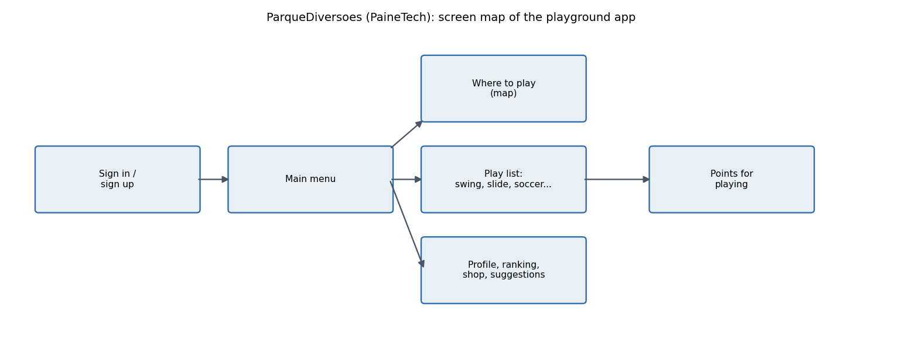
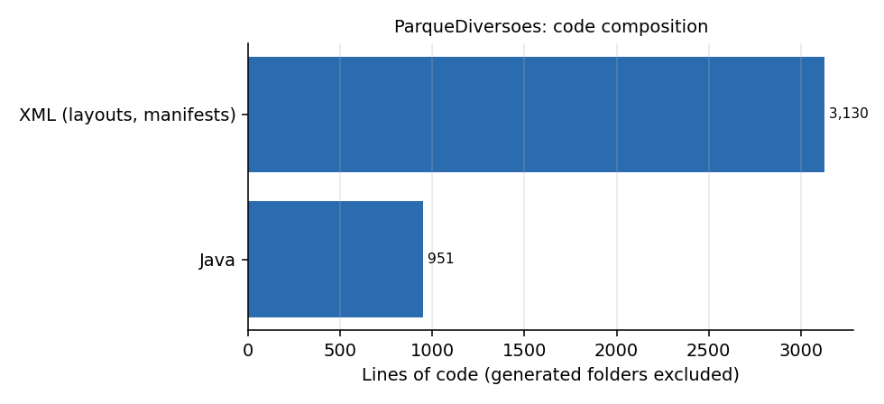

# ParqueDiversoes (PaineTech)

**Android app prototype that gamifies outdoor play: find a playground on a map, choose an activity, earn points, climb a ranking.** Android team project (the resources mention a team called PaineTech). *Em portugues: prototipo de aplicativo para incentivar criancas a brincar ao ar livre, com mapa de parques, lista de brincadeiras, pontos e ranking.*

## Screens

| Area | Classes |
|---|---|
| Entry | `MainActivity`, `login`, `Cadastrar` (sign-up with avatar choice A to F) |
| Hub | `MenuInicial`: map, where to play, profile, ranking, suggestions, shop, about |
| Maps | `OndeBrincar` and `MapsActivity` (Google Maps fragment) |
| Activities | `BrincadeirasLista` leads to `Balanco`, `Basquete`, `Escorregador`, `Futebol`, `RodaRoda`, `Skate`, `VamosBrincar` (each shows the activity and awards points through a dialog) |
| Social | `MeuPerfil`, `Ranking`, `Sugestoes`, `lojinha` |

## Honest scope

A **UI prototype**: 19 screens and their navigation. Points are announced in dialogs but not stored, ranking and shop are static layouts, and there is no backend. The value of the project is the product design and the navigation structure (shown in the diagram above, generated from the `Intent` calls in the source), not the data layer.

## Build

Android Studio, SDK 29. Add your own Google Maps key (placeholder `YOUR_GOOGLE_MAPS_API_KEY` in `AndroidManifest.xml` and `app/src/debug/res/values/google_maps_api.xml`). Libraries: AndroidX, Material, ZXing, Glide, Google Maps SDK.

## Notes

IDE and build folders were removed from the repository and are ignored. The original Maps key remains in the git history; treat it as public and restrict or delete it in Google Cloud.
